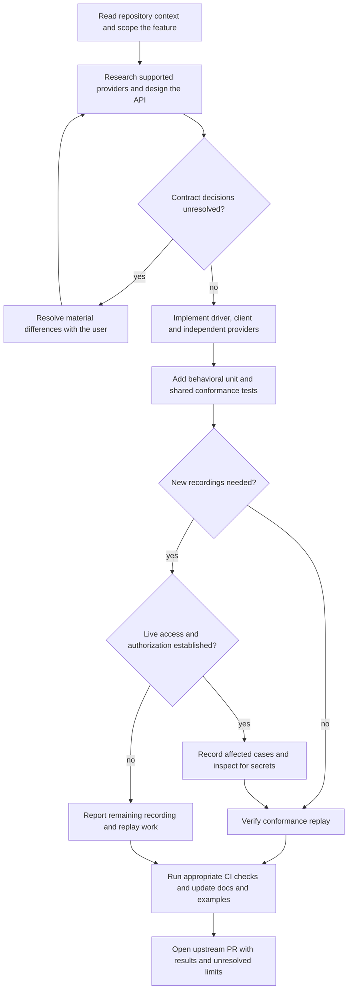

# Cross-provider feature development

Read `AGENTS.md`, the target service's implementation and tests, and
`.github/workflows/ci.yml`. Use the public repository's current contracts,
package names, and checks. Bug fixes without an API change can use a focused
debugging workflow; documentation-only changes use `multi-cloudpy-docs-guides`.

## Process Flow

This summarizes the workflow below. When porting a Java SDK feature, use the
MultiCloudJ API as a reference and adapt it to the current Python contracts.



## Establish the contract

Identify the service, operation, intended observable behavior, and supported
providers from the request and existing code. Ask only for missing decisions
that materially change the API. Research the official provider SDK operations,
limits, pagination, consistency, and error behavior before implementation.
Present material provider differences and resolve the cloud-agnostic contract
with the user when the request has not already settled it.

Use direct arguments and keyword-only optional parameters, with existing typed
result/dataclass conventions. Do not add request wrappers. If a capability is
provider-specific, discuss the scope in an issue before adding it to a shared
API. Do not claim support by implementing a silent fallback that changes its
meaning. Ali distributions are placeholders; preserve that status unless
implementing that provider is explicitly part of the task.

## Follow all three layers

Source paths are under
`packages/SERVICE/multicloud-SERVICE/multicloud/SERVICE/SERVICE_client/`.
Provider distributions sit alongside that directory; published names use
`multicloud-py-`, and the provider identifier is `ali` for Ali.

1. Extend the driver contract in `driver.py`, using the existing validator
   and a `do_*` hook. Put common normalization in the driver.
2. Add the public client method in `client.py`. It forwards to the driver
   and owns exception translation through the provider's `translate_error`.
3. Implement each supported provider's hook independently, using its native
   SDK. Do not catch merely to translate inside provider operations.
4. Extend error classification as needed. Mapping returns the common exception
   type and preserves exceptions already translated; request-specific behavior
   stays at the operation boundary.

Keep common and client/driver code independent of provider dependencies.
Providers must not reference sibling providers, including in comments.
Discover providers through distribution entry points and the existing registry;
do not introduce eager imports into implicit namespace packages.

Check service-specific differences:

- Pub/Sub has separate topic and subscription registries. AWS topic provider
  IDs distinguish `awssns` and `awssqs`; inspect the correct contract.
- Blob has an async stack in `blob_client/async_blob/` and provider-specific
  `async_blob/` directories. Include matching behavior there, or state an
  explicitly agreed async scope. Use the existing async dependency-injection
  fixtures rather than sync-client mocks.
- DocStore uses action/query contracts. Inspect its driver before assuming
  every service shares blob's operation shape or validation helpers.

## Test observable behavior

Add unit tests under `tests/SERVICE/unit/`, injecting mocks for native SDK
collaborators rather than mocking the provider under test. Check request
transformation, returned values, validation, and translated errors. Assert
specific failures, not just non-null results or broadly caught exceptions.

Add shared happy-path and error-path conformance cases under
`tests/SERVICE/conformance/`. Run concrete provider classes, not abstract
base suites. Use round trips, unique resource names, and cleanup; keep shared
assertions cloud-agnostic. Consult existing HTTP and gRPC fixture machinery
for the service instead of assuming all recordings use one transport.

Replay uses `--record-mode=none`. Recording with `--record-mode=rewrite`
requires live cloud access and overwrites fixtures: first establish the test
account, intended resources, credentials, and authorization. Run one provider
at a time, inspect the full recording diff for secrets, then verify replay.
Do not fabricate recordings or weaken assertions to make a test pass. If
recording is blocked by unavailable credentials, report the exact remaining
work rather than claiming conformance passed.

## Validate and submit

Use the locked uv workspace. Run the target service's checks during development
and the CI checks appropriate to the completed change before opening the PR:

```bash
uv sync --frozen --all-groups --all-packages
uv run --frozen python -m black --check packages tests scripts
uv run --frozen python -m isort --check-only packages tests scripts
uv run --frozen python scripts/sync_version.py --check
uv run --frozen python -m pytest -m 'not conformance'
uv run --frozen python -m pytest -m conformance --record-mode=none
```

Consult `Makefile` for coverage targets and `pyproject.toml` for typing settings;
do not invent a coverage threshold or claim an advisory check is a CI gate.
Update Google-style docstrings, relevant examples, and guides. Verify example
imports against the real `SERVICE_client` exports.

## Open the PR

The only PR target is `main` of `https://github.com/salesforce/multicloud-py`.
This holds regardless of what `origin` points to, which remotes exist, or where
earlier PRs in the checkout went. Never open the PR against an internal mirror,
another host, or a fork's own default branch. Do not add internal work-item
prefixes to the branch, commit, or title.

1. Run `git remote -v` and `gh auth status --hostname github.com`. If no
   remote's push URL is a github.com fork of `salesforce/multicloud-py` (or
   upstream itself, with write access), stop and ask the user which GitHub
   fork to push to.
2. Branch from an up-to-date `salesforce/multicloud-py:main`, commit with a
   conventional `feat:` title, and push the branch to that GitHub fork.
3. Create the PR with an explicit upstream target:

   ```bash
   gh pr create --repo salesforce/multicloud-py --base main \
     --head FORK_OWNER:BRANCH --title "feat(SERVICE): ..." --body-file BODY.md
   ```

   The body describes the contract, supported providers, tests run with their
   results, and any unresolved limits.
4. Confirm the target with
   `gh pr view URL --json url,baseRefName,headRepositoryOwner` and check that
   the URL starts with `https://github.com/salesforce/multicloud-py/pull/`.

Finish by giving the user the PR URL printed by `gh pr create`, as a full
link, in the final message. If the PR could not be created, say so and report
the pushed branch and the exact failing step instead. No internal ticket or CI
access is required for public contribution.
